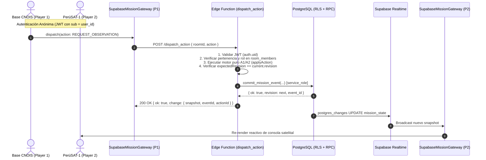

# PERUSAT CREW · Especificación de Edge Functions y Contrato Supabase (Rol 01 ↔ Rol 02)

**Fecha:** 15 de noviembre de 2026  
**Autores:** Rol 01 (Arquitectura Frontend e Integración) en coordinación con Rol 02 (Reglas del Dominio y Backend)  
**Proyecto:** PERUSAT CREW: Operación El Niño (NASA Space Apps Challenge 2026)  
**Versión de Esquema:** `schemaVersion: 3` (Contratos v3)

---

## 1. Resumen Ejecutivo y Arquitectura

Esta especificación formaliza la interfaz de comunicación entre el cliente web (React + Phaser 4 + `SupabaseMissionGateway`) y la infraestructura de backend en Supabase (PostgreSQL RLS, Edge Functions en Deno y Realtime).



---

## 2. Autenticación y Criptografía de Sesión

1. **Autenticación Anónima:**
   El frontend utiliza `supabase.auth.signInAnonymously()`. Cada navegador recibe un `user_id` (UUIDv4) persistido en `localStorage` sin requerir credenciales ni formulario.
2. **Tokens de Autorización:**
   Cada llamada a las Edge Functions o consultas a la base de datos incluye la cabecera estándar:
   ```http
   Authorization: Bearer <access_token>
   apikey: <anon_public_key>
   ```
3. **Seguridad y Confidencialidad:**
   - **Prohibido:** El frontend jamás contiene ni utiliza la clave `service_role`.
   - **Derivación de Rol:** En modo multijugador, el rol (`ground` o `satellite`) proviene exclusivamente del registro verificado en la tabla `room_members`. La interfaz de usuario bloquea el conmutador de rol para evitar suplantaciones de identidad (*role spoofing*).

---

## 3. Base de Datos y Funciones Almacenadas (RPC)

### 3.1 RPC: `join_room(p_join_code text)`
- **Descripción:** Permite a un jugador autenticado unirse a una sala utilizando el código alfanumérico de 6 caracteres.
- **Permisos:** Ejecutable por el rol `authenticated`.
- **Comportamiento:**
  - Si la sala no existe: `{ "status": "room_not_found" }`.
  - Si el usuario ya es miembro: `{ "status": "already_member", "roomId": "...", "role": "..." }`.
  - Si la sala ya cuenta con 2 tripulantes: `{ "status": "room_full" }`.
  - Si hay un rol disponible: Registra al usuario en `room_members` con el rol complementario y retorna `{ "status": "joined", "roomId": "...", "role": "..." }`.

---

## 4. Endpoints de Edge Functions

### 4.1 `POST /functions/v1/create_room`

Crea una nueva sala de misión e inicializa el estado con el escenario seleccionado.

#### Cabeceras
```http
Content-Type: application/json
Authorization: Bearer <jwt_del_jugador>
```

#### Request Body
```json
{
  "scenarioId": "A1",
  "ownerRole": "ground"
}
```
- `scenarioId`: `"A1"` (rutinaria) o `"A2"` (emergencia lluvias/nubes).
- `ownerRole`: `"ground"` o `"satellite"`.

#### Response Exitosa (200 OK)
```json
{
  "roomId": "f47ac10b-58cc-4372-a567-0e02b2c3d479",
  "joinCode": "PIU92X",
  "role": "ground"
}
```

---

### 4.2 `POST /functions/v1/dispatch_action`

Endpoint transaccional central. Valida el actor, comprueba el control de concurrencia optimista (`expectedRevision`), ejecuta el motor de reglas de Misión A y persiste el cambio atómicamente.

#### Cabeceras
```http
Content-Type: application/json
Authorization: Bearer <jwt_del_jugador>
```

#### Request Body
```json
{
  "roomId": "f47ac10b-58cc-4372-a567-0e02b2c3d479",
  "action": {
    "actionId": "9b1deb4d-3b7d-4bad-9bdd-2b0d7b3dcb6d",
    "actorRole": "ground",
    "type": "REQUEST_OBSERVATION",
    "expectedRevision": 0,
    "payload": {
      "targetId": "rio-piura",
      "priority": "critical"
    }
  }
}
```

#### Response Exitosa (200 OK)
```json
{
  "ok": true,
  "change": {
    "eventId": "evt-7a8b9c-1234",
    "actionId": "9b1deb4d-3b7d-4bad-9bdd-2b0d7b3dcb6d",
    "snapshot": {
      "schemaVersion": 3,
      "roomId": "f47ac10b-58cc-4372-a567-0e02b2c3d479",
      "revision": 1,
      "phase": "plan",
      "status": "in_progress",
      "score": 0,
      "selectedTargetId": "rio-piura",
      "requestedTargetId": "rio-piura",
      "priority": "critical",
      "energyWh": 95,
      "batteryMaxWh": 100,
      "downlinkSeconds": 80,
      "downlinkMaxSeconds": 80,
      "budgetCredits": 90,
      "observations": [],
      "unlockedAchievements": []
    }
  }
}
```

#### Respuestas de Error
- **Revisión Obsoleta (409 Conflict):**
  ```json
  {
    "ok": false,
    "code": "stale",
    "message": "Revisión 0 obsoleta; el servidor se encuentra en revisión 1."
  }
  ```
- **Acción Denegada por Reglas (400 Bad Request):**
  ```json
  {
    "ok": false,
    "code": "WRONG_ROLE",
    "message": "Solo la Base CNOIS puede solicitar observaciones prioritarias."
  }
  ```
- **Acción Duplicada Idempotente (200 OK o 409 Conflict):**
  ```json
  {
    "ok": false,
    "code": "duplicate",
    "message": "La acción 9b1deb4d ya fue procesada anteriormente."
  }
  ```

---

## 5. Suscripción en Tiempo Real (Realtime)

1. **Canal:** `mission-room:<roomId>`
2. **Evento de Postgres Changes:**
   ```typescript
   supabase
     .channel(`mission-room:${roomId}`)
     .on(
       'postgres_changes',
       {
         event: 'UPDATE',
         schema: 'public',
         table: 'mission_state',
         filter: `room_id=eq.${roomId}`
       },
       (payload) => {
         // payload.new.snapshot contiene el estado actualizado
       }
     )
     .subscribe();
   ```
3. **Manejo de Desconexión / Reconexión:**
   `SupabaseMissionGateway` monitoriza los estados `SUBSCRIBED`, `TIMED_OUT`, `CLOSED` y ejecuta automáticamente una sincronización de snapshot (`getSnapshot`) tras reconectar para asegurar que no se pierdan cambios ocurridos durante microcortes de red.

---

## 6. Procedimiento de Verificación en Pruebas Multijugador

Una vez desplegadas las migraciones y Edge Functions por el Rol 02:
1. Copiar `.env.example` a `.env.local` con `VITE_SUPABASE_URL` y `VITE_SUPABASE_ANON_KEY`.
2. Navegador 1 (Anfitrión):
   - Abrir aplicación web.
   - Clic en `[💻 Modo Local]` para abrir el Lobby.
   - Pestaña `🚀 Crear Sala`, seleccionar `A1` y rol `Base CNOIS`.
   - Clic en `Crear Sala y Obtener Código`. Copiar código generado (ej: `PIU92X`).
3. Navegador 2 (Invitado en ventana de incógnito u otro dispositivo):
   - Abrir aplicación web.
   - Clic en `[💻 Modo Local]` para abrir el Lobby.
   - Pestaña `🛰️ Unirse con Código`, pegar `PIU92X`.
   - Clic en `Unirse a la Misión`. El servidor asignará automáticamente `PerúSAT-1`.
4. Ambos jugadores operan sus estaciones en vivo; cada acción se refleja en tiempo real en la pantalla del compañero.
