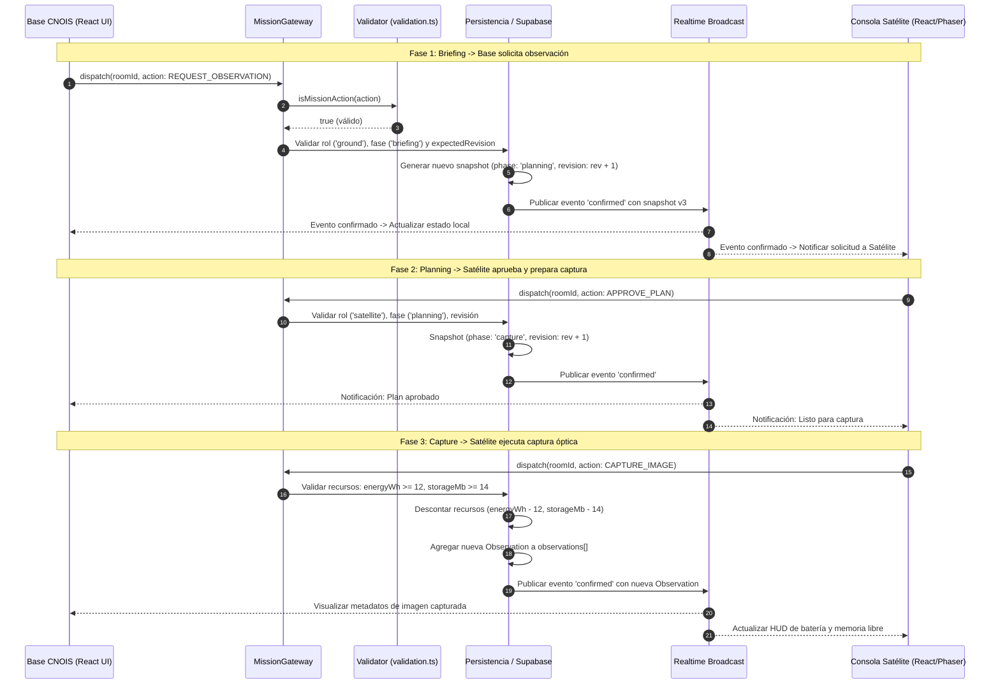
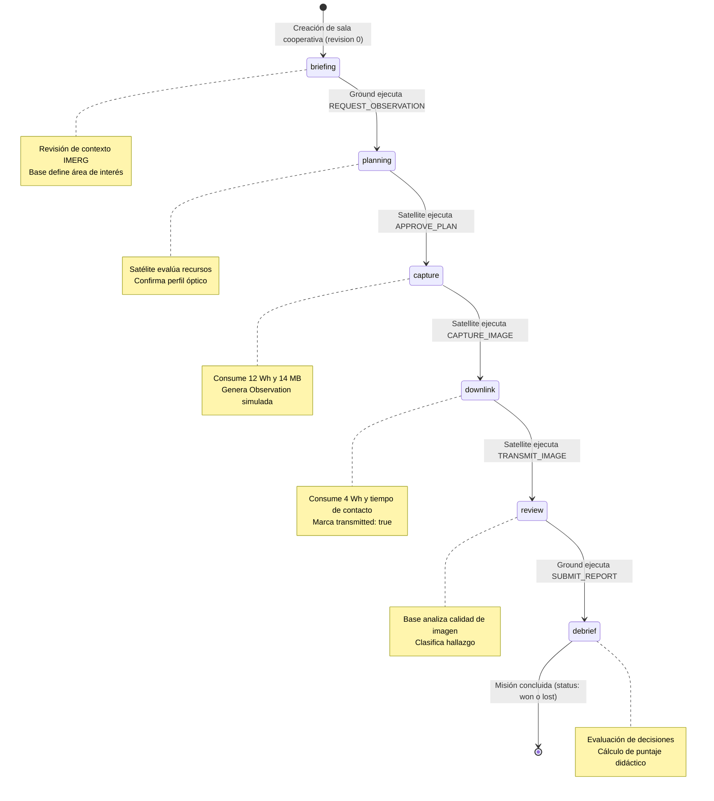

# PERUSAT CREW: Operación El Niño
## Flujo Técnico y Protocolo de Comunicación

> **Especificación de flujo extremo a extremo para desarrolladores de Roles 01, 02 y 04**
> **Versión de Contrato:** `schemaVersion: 3`

---

## 1. Diagrama de Secuencia Extremo a Extremo

El siguiente diagrama ilustra el ciclo de vida de una acción cooperativa típica (`REQUEST_OBSERVATION` seguida de `CAPTURE_IMAGE`), mostrando el tránsito por las capas de la aplicación:

---

## 2. Máquina de Estados de la Misión (`MissionPhase`)

La misión progresa de manera secuencial a través de fases formales, evitando que los jugadores ejecuten acciones fuera del protocolo operativo:

---

## 3. Protocolo de Transición y Control de Concurrencia

### 3.1 Idempotencia con `actionId`
- Cada acción despachada por el cliente **debe** incluir un `actionId` único generado localmente (por ejemplo, mediante `crypto.randomUUID()`).
- Si un reintento por fluctuación de red envía dos veces el mismo `actionId`, el backend o gateway detecta la clave ya registrada y devuelve el resultado previo **sin volver a descontar energía, memoria ni tiempo de contacto**.

### 3.2 Control de Versiones con `expectedRevision`
- El cliente siempre envía `expectedRevision` igual al valor actual de `snapshot.revision` en su memoria.
- Si otro jugador confirmó una acción una fracción de segundo antes, la revisión en el servidor habrá avanzado, provocando el rechazo atómico con error `REVISION_CONFLICT`.
- Frente a un `REVISION_CONFLICT`, el cliente receptor actualiza su estado con `getSnapshot()` y reevalúa si la acción sigue siendo viable.

### 3.3 Transiciones Atómicas
- En ningún caso el cliente frontend modifica directamente las propiedades de `resources` ni inserta elementos en `observations`.
- Toda mutación pasa por una función validadora o RPC en backend que aplica las invariables del Documento Maestro:
  - Ningún recurso puede quedar con valor negativo (`energyWh >= 0`, `storageMb >= 0`, `contactSeconds >= 0`).
  - La calidad `cloudy`, `corrupt` o `incomplete` no puede computarse como prueba confirmatoria de desastre.

---

## 4. Diferencia Conceptual Crítica: Enlace Físico vs. Conexión de Red

Es fundamental que los desarrolladores de todos los roles distingan claramente dos conceptos que no deben confundirse:

| Dimensión | `contactSeconds` (Simulación Espacial) | `ConnectionState` (Red Web / Supabase) |
|---|---|---|
| **Qué representa** | La ventana física en la que PerúSAT-1 tiene línea de vista con la antena del CNOIS en Punta Hermosa (Lima). | La conexión WebSockets / HTTPS entre los navegadores de los jugadores e Internet. |
| **Comportamiento al agotarse** | Se suspende temporalmente la bajada de imágenes (`TRANSMIT_IMAGE`). Se muestra alerta didáctica: *«Ventana de contacto cerrada»*. | Se despliega estado `reconnecting` o `disconnected`. Se activa reintento automático de red. |
| **Efecto en la aplicación** | La sala y el chat siguen funcionando plenamente; la Base puede continuar analizando datos ya descargados. | La interfaz se protege deshabilitando botones hasta restablecer sincronización. |
| **Regla de oro** | **NUNCA cerrar la sala ni desconectar el juego cuando `contactSeconds` llegue a 0.** | **Proveer feedback no invasivo mientras se restablece el socket.** |
